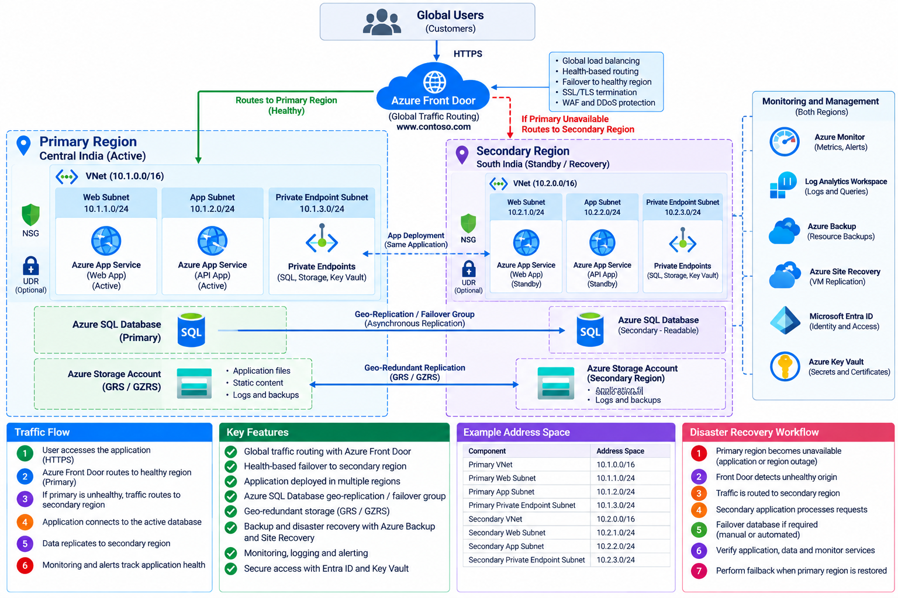

# Highly Available Global Application and Disaster Recovery

A **Highly Available Global Application** is designed to remain accessible during infrastructure failures, application failures, and regional outages. Disaster recovery helps restore application services and data when a major disruption occurs.

This project demonstrates how to design a resilient multi-region application using Azure Front Door, Azure App Service, Azure SQL Database, geo-redundant storage, and Azure monitoring services.

---

## Architecture Diagram

---

## Table of Contents

- [Overview](#overview)
- [High Availability and Disaster Recovery](#high-availability-and-disaster-recovery)
- [Azure Resources and Their Purpose](#azure-resources-and-their-purpose)
- [Primary and Secondary Region Design](#primary-and-secondary-region-design)
- [Global Traffic Routing](#global-traffic-routing)
- [Application Failover](#application-failover)
- [Database Replication and Failover](#database-replication-and-failover)
- [Storage Redundancy](#storage-redundancy)
- [Backup and Disaster Recovery](#backup-and-disaster-recovery)
- [Security and Monitoring](#security-and-monitoring)
- [Implementation Steps](#implementation-steps)
- [Failover Testing and Troubleshooting](#failover-testing-and-troubleshooting)
- [Conclusion](#conclusion)
- [Microsoft Documentation](#microsoft-documentation)

---

## Overview

A single-region application can become unavailable if a regional outage affects its compute resources, database, or networking services.

A multi-region architecture reduces this risk by deploying application resources in a primary region and maintaining a recovery environment in a secondary region.

### Real-World Scenario

An enterprise hosts a business application used by customers worldwide.

- The primary region serves normal application traffic.
- The secondary region contains a separately deployed application environment.
- Azure Front Door routes requests to healthy application origins.
- Azure SQL Database uses cross-region replication or a failover group.
- Azure Storage uses an appropriate redundancy configuration.
- Azure Monitor provides visibility into application health and resource failures.

If the primary application region becomes unavailable, traffic can be redirected to the healthy secondary application. Database failover and data recovery must be handled according to the configured recovery strategy.

---

## High Availability and Disaster Recovery

### 1. High Availability

High availability minimizes service interruption when individual components fail.

Examples include:

- Deploying application instances across availability zones where supported.
- Using health probes to detect unhealthy application endpoints.
- Using Azure Front Door to route traffic to healthy origins.
- Configuring appropriate database availability and redundancy.

### 2. Disaster Recovery

Disaster recovery focuses on restoring service following a major incident, such as a regional outage.

Examples include:

- Maintaining an application deployment in a secondary region.
- Replicating database changes to a secondary database.
- Configuring geo-redundant storage.
- Maintaining backups and tested recovery procedures.

### Recovery Objectives

| Objective | Meaning |
|---|---|
| Recovery Time Objective (RTO) | The maximum targeted time to restore a service after a disruption. |
| Recovery Point Objective (RPO) | The maximum targeted amount of data loss measured in time. |

RTO and RPO depend on the selected services, replication mode, application design, and recovery procedures.

---

## Azure Resources and Their Purpose

| Azure Resource | Purpose |
|---|---|
| Azure Front Door | Provides global HTTP/HTTPS routing, health-based origin selection, and application delivery. |
| Azure App Service | Hosts the web application in the primary and secondary regions. |
| Azure Virtual Network | Provides private networking when required by the application architecture. |
| Azure SQL Database | Stores application data as a managed database service. |
| SQL Failover Groups | Coordinate replication and failover for selected databases between SQL logical servers in different regions. |
| Azure Storage | Stores application files, documents, and other persistent data. |
| Geo-Redundant Storage (GRS) | Replicates storage data to a secondary region. |
| Geo-Zone-Redundant Storage (GZRS) | Combines zone redundancy in the primary region with replication to a secondary region. |
| Azure Backup | Protects supported workloads and provides backup-based recovery. |
| Azure Site Recovery | Provides disaster recovery capabilities for supported virtual machines and workloads. |
| Azure Monitor | Collects metrics and supports monitoring and alerting. |
| Log Analytics Workspace | Stores and queries logs sent to the workspace by configured integrations. |
| Microsoft Entra ID | Manages identities and access to Azure resources. |
| Azure Key Vault | Stores secrets, keys, and certificates securely. |

---

## Primary and Secondary Region Design

A multi-region application should have a clearly defined primary region and recovery region.

| Component | Primary Region | Secondary Region |
|---|---|---|
| Application | Active application deployment | Recovery or active application deployment |
| Compute | App Service or selected compute service | Corresponding application deployment |
| Database | Primary Azure SQL Database | Geo-replicated secondary database |
| Storage | Primary storage endpoint | Geo-redundant secondary storage, where supported |
| Monitoring | Azure Monitor configuration | Monitoring configured for secondary resources |

For this example, use **Central India** as the primary region and **South India** as the secondary region, subject to the availability of the required services and features.

### Deployment Considerations

- Deploy the application independently in both regions.
- Configure application settings and secrets securely in each region.
- Ensure the secondary environment has sufficient capacity for recovery.
- Configure database replication and storage redundancy separately.
- Test that application dependencies are available in the recovery region.
- Document the failover and failback procedures.

---

## Global Traffic Routing

Azure Front Door provides a global entry point for HTTP/HTTPS applications and supports routing requests to configured origins.

### How Azure Front Door Works

1. A user accesses the application through its domain name.
2. DNS resolves the domain to the Azure Front Door endpoint.
3. Azure Front Door receives the request.
4. Front Door evaluates its routing configuration and origin health.
5. The request is forwarded to an eligible, healthy application origin.
6. If an origin becomes unhealthy, Front Door can route requests to another eligible origin according to the configured origin group and routing settings.

### Origin Configuration

| Setting | Primary Origin | Secondary Origin |
|---|---|---|
| Origin | Primary-region application | Secondary-region application |
| Priority | Higher preference in active-passive designs | Lower preference in active-passive designs |
| Health probe | Application health endpoint | Application health endpoint |
| Purpose | Serves normal traffic | Serves traffic when selected for failover |

For active-passive routing, configure origin priorities appropriately. For active-active routing, configure the origin group and routing method to distribute traffic according to the application requirements.

**Important:** Front Door detects application-origin health; it does not automatically fail over every dependent service. Database, storage, and other dependencies require their own recovery design.

---

## Application Failover

Application failover redirects requests from an unhealthy application endpoint to a healthy alternative.

### Failover Process

1. Azure Front Door probes the configured application health endpoints.
2. The primary application origin becomes unhealthy.
3. Front Door detects the unhealthy origin according to its health-probe configuration.
4. Front Door routes requests to another eligible healthy origin.
5. The secondary application processes incoming requests.
6. Administrators verify application health and investigate the primary-region failure.

### Application Readiness

Before relying on the secondary region, verify that:

- The application is deployed and operational.
- Required configuration values and secrets are available.
- Network access and dependencies are configured.
- The application can connect to the active database.
- The secondary environment can handle the expected workload.

---

## Database Replication and Failover

Azure SQL Database supports cross-region replication for disaster recovery.

### SQL Active Geo-Replication

Active geo-replication maintains a secondary database in another Azure region. It can be used when individual database replication and manually initiated geo-failover meet the application's requirements.

### SQL Failover Groups

Failover groups provide a managed mechanism for coordinating replication and failover for selected databases between Azure SQL logical servers in different regions.

They also provide stable listener endpoints for client connections.

### Database Failover Process

1. Create the primary Azure SQL Database.
2. Configure a secondary logical server in another region.
3. Configure active geo-replication or a failover group.
4. Monitor replication health and lag.
5. Initiate or configure failover according to the recovery policy.
6. Ensure the application uses the appropriate database connection endpoint.
7. Validate database connectivity and data consistency after failover.

### Database Considerations

- Replication may be asynchronous, so recent transactions can be lost during some forced failover scenarios.
- A secondary database does not automatically become the active database simply because Front Door redirects application traffic.
- Application connection strings and retry logic must support recovery.
- Failback to the original region should be planned and tested.

---

## Storage Redundancy

Azure Storage provides multiple redundancy options to protect data against failures.

| Redundancy Option | Description |
|---|---|
| LRS | Replicates data within a single physical location in the primary region. |
| ZRS | Replicates data across availability zones in the primary region. |
| GRS | Replicates data within the primary region and asynchronously to a secondary region. |
| RA-GRS | Provides geo-replication with read access to the secondary region. |
| GZRS | Combines zone redundancy in the primary region with geo-replication. |
| RA-GZRS | Provides zone and geo-redundancy with read access to the secondary region. |

Choose the redundancy option based on application availability requirements, regional support, cost, and recovery objectives.

**Important:** With GRS and GZRS, secondary-region data is not directly available for normal reads and writes unless the applicable failover or read-access configuration supports it. Geo-replication is asynchronous, so the secondary copy may lag behind the primary.

---

## Backup and Disaster Recovery

Replication and backup solve different problems.

- **Replication** helps maintain a secondary copy of data or workloads.
- **Backup** provides recovery points for restoring supported resources after accidental deletion, corruption, or other data-loss events.
- **Azure Site Recovery** supports disaster recovery for eligible virtual machines and workloads.

### Recovery Strategy

1. Identify the resources that require protection.
2. Define RTO and RPO requirements.
3. Configure backup policies for supported resources.
4. Configure replication for workloads requiring regional recovery.
5. Document recovery dependencies and execution order.
6. Test restoration and failover in a controlled environment.
7. Record the results and update the recovery plan.

---

## Security and Monitoring

### Security

- Use Microsoft Entra ID and role-based access control.
- Store secrets and certificates in Azure Key Vault.
- Use HTTPS for public application endpoints.
- Restrict database network access.
- Configure private endpoints where appropriate.
- Apply least-privilege permissions to application identities.
- Protect both primary and secondary environments.

### Monitoring

Configure Azure Monitor and supported diagnostic integrations to track:

- Application availability.
- Front Door origin health.
- Application response times and errors.
- Database health and replication lag.
- Resource utilization.
- Backup and recovery job status.

Send relevant diagnostic logs to Log Analytics where appropriate and configure alerts for conditions that require administrator action.

---

## Implementation Steps

1. Create a resource group and select the required Azure regions.
2. Deploy the application in the primary region.
3. Deploy the application in the secondary region.
4. Configure Azure Front Door with an origin group containing both application endpoints.
5. Configure health probes and routing priorities.
6. Create the primary Azure SQL Database.
7. Configure SQL active geo-replication or a failover group in the secondary region.
8. Configure the application to use the appropriate database listener or connection endpoint.
9. Configure Azure Storage redundancy based on the recovery requirements.
10. Configure Azure Backup and Azure Site Recovery for supported workloads where required.
11. Configure Microsoft Entra ID, managed identities, and Key Vault access.
12. Enable Azure Monitor and configure diagnostic settings.
13. Test application health, database connectivity, and recovery procedures.
14. Document the failover and failback process.

---

## Failover Testing and Troubleshooting

| Test | Expected Result |
|---|---|
| Access the application through Front Door | The request reaches a healthy configured origin. |
| Make the primary origin unhealthy in a controlled test | Front Door routes traffic to another eligible healthy origin according to its configuration. |
| Check the secondary application | The application responds and its dependencies are available. |
| Verify SQL replication | The secondary database replication state and lag can be inspected. |
| Test database failover | The configured database failover process completes and the application reconnects. |
| Verify storage recovery | Data can be accessed or recovered according to the selected redundancy and failover configuration. |
| Restore a protected resource | The supported backup or recovery process restores the resource as expected. |
| Review monitoring data | Configured metrics, alerts, and logs help identify failures. |

### Common Issues

**Front Door does not route to the secondary origin**
- Check origin health, health-probe path, protocol, port, priority, and routing configuration.

**Secondary application is unavailable**
- Check deployment status, application settings, secrets, network access, and dependencies.

**Database connection fails after failover**
- Verify the failover status, listener endpoint, authentication, DNS caching, and application retry logic.

**Database replication is delayed**
- Review replication health, workload pressure, and replication lag.

**Secondary storage data is unavailable**
- Verify the selected redundancy option and whether read access or account failover is required.

**Recovery takes longer than expected**
- Review RTO and RPO assumptions, resource capacity, automation, and the documented recovery procedure.

---

## Conclusion

This project demonstrates how to design a highly available, multi-region application on Azure using global traffic routing, application redundancy, database replication, storage redundancy, backups, and monitoring.

A successful disaster recovery design requires more than deploying resources in two regions. The application, database, storage, networking, identity, and recovery procedures must work together and be tested regularly.

### Key Learning Outcomes

- Design a multi-region Azure architecture.
- Configure Azure Front Door origin routing and health probes.
- Understand active-passive and active-active application deployments.
- Configure Azure SQL Database geo-replication and failover groups.
- Understand Azure Storage geo-redundancy.
- Distinguish high availability, replication, and backup.
- Define RTO and RPO.
- Test regional failover and recovery procedures.

---

## Microsoft Documentation

- [Azure Front Door documentation](https://learn.microsoft.com/en-us/azure/frontdoor/)
- [Secure your Azure Front Door deployment](https://learn.microsoft.com/en-us/azure/frontdoor/secure-front-door)
- [Azure SQL Database failover groups](https://learn.microsoft.com/en-us/azure/azure-sql/database/auto-failover-group-sql-db)
- [Azure SQL Database active geo-replication](https://learn.microsoft.com/en-us/azure/azure-sql/database/active-geo-replication-overview)
- [Azure Storage redundancy](https://learn.microsoft.com/en-us/azure/storage/common/storage-redundancy)
- [Azure Site Recovery documentation](https://learn.microsoft.com/en-us/azure/site-recovery/)

