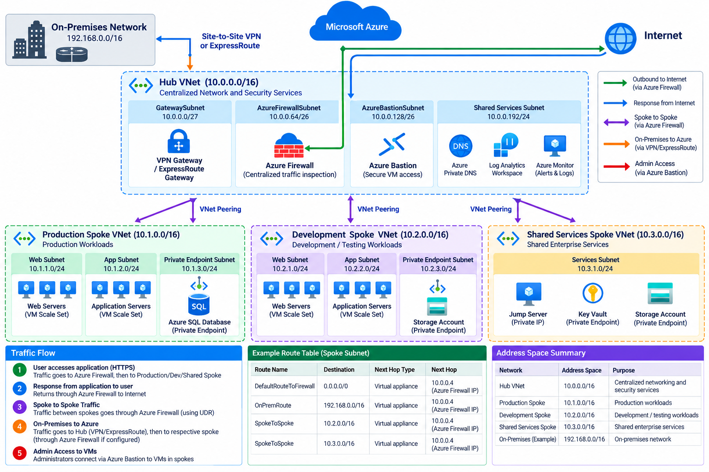

# Secure Enterprise Hub-and-Spoke Architecture

A **Hub-and-Spoke Architecture** is a network topology in Azure where a central hub virtual network provides shared networking and security services to multiple spoke virtual networks. Each spoke hosts workloads such as production applications, development environments, or shared services.

This architecture helps enterprises centralize network security, isolate workloads, manage connectivity, and control traffic between networks.

---

## Architecture Diagram

---

## Table of Contents

- [Overview](#overview)
- [What Is Hub-and-Spoke Architecture?](#what-is-hub-and-spoke-architecture)
- [Azure Resources and Their Purpose](#azure-resources-and-their-purpose)
- [Network Addressing and Subnets](#network-addressing-and-subnets)
- [VNet Peering and Connectivity](#vnet-peering-and-connectivity)
- [Traffic Flow](#traffic-flow)
- [User-Defined Routes](#user-defined-routes)
- [Security and Access Control](#security-and-access-control)
- [Implementation Steps](#implementation-steps)
- [Testing and Troubleshooting](#testing-and-troubleshooting)
- [Conclusion](#conclusion)
- [Microsoft Documentation](#microsoft-documentation)

---

## Overview

In a traditional enterprise network, every application environment may require its own networking and security configuration. This can increase operational complexity and make centralized security management difficult.

Azure Hub-and-Spoke Architecture addresses this by separating shared network services from application workloads.

### Real-World Scenario

An enterprise operates three environments:

- **Production:** Hosts business-critical applications.
- **Development:** Hosts development and testing workloads.
- **Shared Services:** Hosts common services required by multiple environments.

A central hub VNet hosts Azure Firewall and Azure Bastion. If hybrid connectivity is required, the hub can also host Azure VPN Gateway or an ExpressRoute gateway.

Each spoke VNet connects to the hub through VNet peering. User-defined routes (UDRs) direct selected traffic through Azure Firewall when centralized inspection is required.

---

## What Is Hub-and-Spoke Architecture?

The architecture contains two main components.

### 1. Hub Virtual Network

The hub is the central network that provides shared connectivity and security services.

Typical resources include:

- Azure Firewall
- Azure Bastion
- Azure VPN Gateway, when required
- ExpressRoute gateway, when required
- Shared networking and DNS services, when required

### 2. Spoke Virtual Networks

Spokes are separate virtual networks connected to the hub. Each spoke can host a different workload or environment.

Examples include:

- Production VNet
- Development VNet
- Shared Services VNet

Spokes can be isolated from one another while still accessing approved services through the hub.

**Important:** VNet peering is non-transitive. Two spokes connected to the same hub do not automatically communicate with each other through that hub. Explicit routing and appropriate peering settings are required when traffic must pass through Azure Firewall.

---

## Azure Resources and Their Purpose

| Azure Resource | Purpose |
|---|---|
| Azure Virtual Network | Provides private network isolation for the hub and spokes. |
| Hub VNet | Hosts shared networking and security services. |
| Spoke VNets | Isolate production, development, and other workloads. |
| VNet Peering | Connects hub and spoke virtual networks over the Azure backbone. |
| Azure Firewall | Centrally filters and inspects permitted network traffic. |
| Azure Bastion | Provides secure RDP/SSH access to VMs without requiring public IP addresses on those VMs. |
| Azure VPN Gateway | Provides encrypted connectivity between Azure and remote networks. |
| ExpressRoute Gateway | Connects a VNet to an ExpressRoute circuit. |
| Route Tables | Store user-defined routes for controlling traffic paths. |
| User-Defined Routes | Direct selected traffic to Azure Firewall or another network virtual appliance. |
| Network Security Groups | Filter network traffic at subnet or network interface level. |
| Azure Private DNS | Supports private name resolution for connected workloads and services. |
| Azure Monitor | Collects supported metrics and provides monitoring and alerts. |
| Log Analytics Workspace | Stores and queries logs sent to it by configured monitoring integrations. |

---

## Network Addressing and Subnets

For this lab, use the following example address spaces. Ensure they do not overlap with each other or with any connected on-premises networks.

| Network | Address Space | Purpose |
|---|---|---|
| Hub VNet | `10.0.0.0/16` | Central networking and security |
| Production Spoke | `10.1.0.0/16` | Production workloads |
| Development Spoke | `10.2.0.0/16` | Development workloads |
| Shared Services Spoke | `10.3.0.0/16` | Shared enterprise services |

### Example Hub Subnets

| Subnet | Address Range | Purpose |
|---|---|---|
| AzureFirewallSubnet | `10.0.0.0/26` | Dedicated subnet for Azure Firewall |
| AzureBastionSubnet | `10.0.1.0/26` | Dedicated subnet for Azure Bastion |
| GatewaySubnet | `10.0.2.0/27` | Reserved subnet for a VPN or ExpressRoute virtual network gateway, if required |

These are example ranges, not mandatory values. Verify the current subnet sizing requirements for each Azure service before deployment. In particular, Azure Bastion sizing depends on the selected configuration and features.

### Example Spoke Subnets

| Spoke | Subnet | Address Range |
|---|---|---|
| Production | Production-Workload | `10.1.1.0/24` |
| Development | Development-Workload | `10.2.1.0/24` |
| Shared Services | Shared-Workload | `10.3.1.0/24` |

You can create additional subnets for web servers, application servers, databases, and private endpoints based on workload requirements.

---

## VNet Peering and Connectivity

VNet peering connects the hub VNet to each spoke VNet using private IP connectivity over the Azure backbone.

Configure the following peerings:

- Hub VNet to Production Spoke
- Hub VNet to Development Spoke
- Hub VNet to Shared Services Spoke

### Peering Configuration

1. Open the hub VNet in the Azure portal.
2. Select **Peerings** under Settings.
3. Select **Add**.
4. Select the appropriate spoke VNet.
5. Configure the required peering options.
6. Create the reciprocal peering if it is not automatically created.
7. Verify that the peering status is **Connected**.

### Gateway Transit

When on-premises connectivity is required, the hub can provide a shared VPN or ExpressRoute gateway to the spokes.

Configure gateway transit and remote gateway settings on the appropriate peering connections. Gateway transit does not automatically configure every required route or firewall rule; validate the complete routing design.

---

## Traffic Flow

### 1. Spoke-to-Internet Traffic

1. A workload in a spoke sends traffic to an external destination.
2. A UDR associated with the spoke subnet directs the applicable traffic to Azure Firewall.
3. Azure Firewall evaluates the traffic against its configured rules.
4. If the traffic is allowed, the firewall forwards it toward the destination.
5. Return traffic follows the applicable Azure routing and stateful firewall behavior.

### 2. Spoke-to-Spoke Traffic

1. A workload in the Production Spoke sends traffic to a resource in the Development Spoke.
2. The Production subnet's route table directs the destination prefix through Azure Firewall.
3. The firewall evaluates the traffic against its network rules.
4. If allowed, the firewall forwards traffic toward the Development Spoke.
5. The Development Spoke must have compatible routing for the return path.

**Important:** Configure the relevant destination-specific routes and peering options. A default route alone does not guarantee that all traffic between directly peered VNets will pass through Azure Firewall.

### 3. Administrator-to-VM Traffic

1. An administrator connects to Azure Bastion through the Azure portal or a supported client.
2. Bastion establishes an RDP or SSH connection to the target VM using its private IP address.
3. NSGs and the VM operating system firewall must permit the required management traffic.

### 4. On-Premises-to-Azure Traffic

When hybrid connectivity is configured:

1. On-premises traffic enters Azure through the VPN or ExpressRoute gateway.
2. Azure routes the traffic according to the configured routing design.
3. Azure Firewall inspects traffic that is routed through it.
4. Approved traffic reaches the destination workload.

---

## User-Defined Routes

User-defined routes control how traffic is forwarded from subnet resources.

For example, to route internet-bound traffic through Azure Firewall, create a route table with the following route and associate it with the required spoke subnet.

| Setting | Value |
|---|---|
| Route name | `DefaultRouteToFirewall` |
| Destination type | IP Addresses |
| Destination prefix | `0.0.0.0/0` |
| Next hop type | Virtual appliance |
| Next hop address | Azure Firewall private IP address |

### Configure a Route Table

1. Open the Azure portal.
2. Search for **Route tables**.
3. Create a route table in the appropriate resource group and region.
4. Open **Routes** and select **Add**.
5. Enter the destination prefix.
6. Select **Virtual appliance** as the next hop type.
7. Enter the private IP address of Azure Firewall.
8. Associate the route table with the intended spoke subnet.
9. Review the effective routes on the workload VM.

Create additional destination-specific routes when required for spoke-to-spoke or on-premises connectivity.

---

## Security and Access Control

### Network Security

- Use Azure Firewall to centrally enforce network and application rules.
- Apply NSGs to limit traffic between workload subnets.
- Use UDRs to direct the intended traffic through the firewall.
- Avoid exposing workload VMs directly to the public internet.
- Use Azure Bastion for administrative access where appropriate.
- Review effective routes and firewall logs during troubleshooting.

### Network Isolation

- Separate production and development workloads into different spoke VNets.
- Allow only the communication required between environments.
- Avoid creating direct spoke-to-spoke peerings unless the architecture requires them.
- Ensure return routes are compatible with the intended traffic path.

### Hybrid Connectivity

- Use VPN Gateway for encrypted connectivity over the internet when appropriate.
- Use ExpressRoute when private connectivity through an ExpressRoute provider is required.
- Configure gateway transit and route propagation according to the network design.

### Monitoring

- Enable supported Azure Firewall diagnostic logs.
- Send diagnostic data to Log Analytics where appropriate.
- Configure Azure Monitor alerts for relevant network and resource conditions.
- Use Network Watcher tools to diagnose connectivity and routing problems.

---

## Implementation Steps

1. Create a resource group.
2. Create the Hub VNet with a non-overlapping address space.
3. Create the required hub subnets, including `AzureFirewallSubnet`.
4. Create the Production, Development, and Shared Services spoke VNets.
5. Deploy Azure Firewall in the hub.
6. Configure Azure Firewall Policy and the required network or application rules.
7. Deploy Azure Bastion if secure VM administration is required.
8. Deploy VPN Gateway or an ExpressRoute gateway if hybrid connectivity is required.
9. Create VNet peering between the hub and each spoke.
10. Configure gateway transit and remote gateway settings if needed.
11. Create route tables and UDRs for the intended traffic paths.
12. Associate the route tables with the appropriate spoke subnets.
13. Configure NSGs for workload isolation.
14. Deploy test VMs or application resources into the spokes.
15. Configure Azure Monitor, diagnostic settings, and Log Analytics.
16. Test connectivity, firewall rules, and the intended traffic paths.

---

## Testing and Troubleshooting

| Test | Expected Result |
|---|---|
| Check VNet peering | Hub and spoke peerings show Connected. |
| Check effective routes | The intended route to Azure Firewall is present. |
| Test allowed outbound traffic | Traffic passes when permitted by the firewall and routing configuration. |
| Test denied traffic | Traffic is blocked when no applicable firewall rule permits it. |
| Test spoke-to-spoke traffic | Communication follows the intended firewall inspection path when configured. |
| Connect through Azure Bastion | Authorized administrators can access the target VM without a public IP on the VM. |
| Test hybrid connectivity | Approved traffic reaches the connected remote network when gateway and routes are configured. |
| Review firewall logs | Available diagnostic logs show relevant traffic and rule decisions. |

### Common Issues

**VNet peering is not connected**
- Verify the remote VNet, peering configuration, and peering status on both sides.

**Traffic bypasses Azure Firewall**
- Review UDRs, effective routes, destination prefixes, and peering settings.
- Check whether direct VNet peering provides a more specific route.

**Traffic is blocked by Azure Firewall**
- Review firewall rules, policy priority, destination addresses, ports, and protocols.

**Spokes cannot communicate**
- Remember that VNet peering is non-transitive.
- Configure the intended firewall routing, compatible routes, peering options, and return path.

**On-premises connectivity fails**
- Check gateway configuration, address-space overlap, route propagation, BGP settings where applicable, and NSGs.

**Bastion cannot connect to a VM**
- Verify Bastion deployment, target VM reachability, NSG rules, and RDP/SSH configuration.

---

## Conclusion

This project demonstrates how to design a secure enterprise network using Azure Hub-and-Spoke Architecture.

The hub provides centralized networking and security services, while spoke VNets isolate workloads. VNet peering provides connectivity, and Azure Firewall with appropriate UDRs enables centralized traffic inspection where required.

### Key Learning Outcomes

- Design a hub-and-spoke network topology.
- Configure Azure VNets and subnet address spaces.
- Understand VNet peering and its non-transitive behavior.
- Deploy Azure Firewall and configure UDRs.
- Use Azure Bastion for secure VM administration.
- Understand VPN Gateway, ExpressRoute, and gateway transit.
- Monitor and troubleshoot network connectivity.

---

## Microsoft Documentation

- [Hub-spoke network topology in Azure](https://learn.microsoft.com/en-us/azure/architecture/networking/architecture/hub-spoke)
- [Hub-and-spoke network topology](https://learn.microsoft.com/en-us/azure/networking/design-guide/hub-spoke)
- [Azure Firewall and traffic inspection](https://learn.microsoft.com/en-us/azure/networking/design-guide/azure-firewall)
- [Deploy and configure Azure Firewall and policy in a hybrid network](https://learn.microsoft.com/en-us/azure/firewall/tutorial-hybrid-portal-policy)

