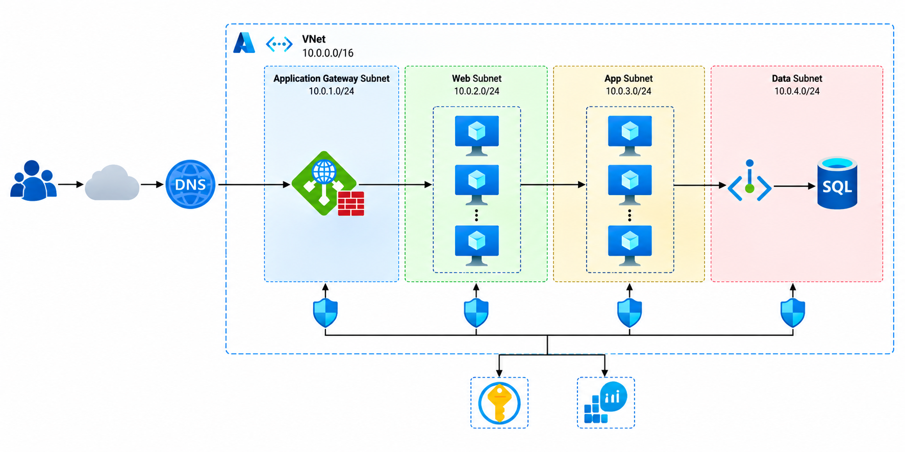

# Three-Tier Enterprise Web Application

A **Three-Tier Enterprise Web Application** is an architecture that separates an application into three layers: presentation, application, and database. This design improves security, scalability, and maintainability.

## Architecture Diagram

Add your Azure architecture image inside the `assets` folder and update the filename below if needed.

---

## Table of Contents

- [Overview](#overview)
- [Three-Tier Architecture](#three-tier-architecture)
- [Azure Resources and Their Purpose](#azure-resources-and-their-purpose)
- [Virtual Network and Subnet Design](#virtual-network-and-subnet-design)
- [Request and Data Flow](#request-and-data-flow)
- [Resource Communication](#resource-communication)
- [Security and Access Control](#security-and-access-control)
- [Implementation Steps](#implementation-steps)
- [Testing and Troubleshooting](#testing-and-troubleshooting)

---

## Overview

This project demonstrates how to design a secure enterprise web application using Azure networking, compute, database, identity, and monitoring services.

### Real-World Scenario

An enterprise hosts a web application that users access through a public domain. Incoming traffic is inspected and routed through Azure Application Gateway. Application workloads run on Virtual Machine Scale Sets, while application data is stored in Azure SQL Database using private connectivity.

---

## Three-Tier Architecture

### 1. Presentation Tier

Receives user requests and routes HTTP/HTTPS traffic to the application.

**Azure services:**
- Azure DNS
- Azure Application Gateway
- Web Application Firewall (WAF)

### 2. Application Tier

Processes application logic and handles requests. Virtual Machine Scale Sets can scale application instances according to workload demand.

**Azure services:**
- Azure Virtual Machine Scale Sets
- Azure Virtual Network
- Network Security Groups (NSGs)

### 3. Database Tier

Stores application data and provides controlled access to the database.

**Azure services:**
- Azure SQL Database
- Azure Private Endpoint
- Azure Private DNS Zone

---

## Azure Resources and Their Purpose

| Azure Resource | Purpose |
|---|---|
| Azure DNS | Resolves the application's domain name. |
| Application Gateway | Routes incoming HTTP/HTTPS requests to backend instances. |
| Web Application Firewall | Helps protect the application from common web attacks. |
| Virtual Network | Provides private network connectivity for Azure resources. |
| Application Gateway Subnet | Dedicated subnet for Application Gateway. |
| Web Subnet | Hosts web-tier resources if a separate web tier is deployed. |
| Application Subnet | Hosts application servers and business logic. |
| Private Endpoint | Provides private connectivity to Azure SQL Database. |
| Network Security Groups | Control allowed inbound and outbound network traffic. |
| Virtual Machine Scale Sets | Deploy and scale application virtual machines. |
| Azure SQL Database | Stores application data as a managed database service. |
| Private DNS Zone | Resolves the database hostname to its private endpoint IP address. |
| Microsoft Entra ID | Manages identities and access to Azure resources. |
| Managed Identity | Enables supported Azure services to authenticate without storing credentials in code. |
| Azure Key Vault | Stores secrets, keys, and certificates securely. |
| Azure Monitor | Collects metrics and supports alerts. |
| Log Analytics Workspace | Stores and queries collected logs for troubleshooting. |

---

## Virtual Network and Subnet Design

Create an Azure Virtual Network with the address space `10.0.0.0/16`.

| Subnet | Address Range | Purpose |
|---|---|---|
| Application Gateway Subnet | `10.0.1.0/24` | Hosts Application Gateway. |
| Web Subnet | `10.0.2.0/24` | Hosts web-tier resources when required. |
| Application Subnet | `10.0.3.0/24` | Hosts application workloads. |
| Private Endpoint Subnet | `10.0.4.0/24` | Hosts the SQL Database private endpoint. |

**Important:**
- Application Gateway requires a dedicated subnet.
- Do not name the Application Gateway subnet `GatewaySubnet`; that name is reserved for Azure VPN Gateway.
- Azure SQL Database is a managed PaaS service and does not reside directly inside the VNet. Its private endpoint resides in the VNet.
- Configure NSGs to allow only the traffic required between application components.

---

## Request and Data Flow

1. The user accesses the application using its domain name.
2. Azure DNS resolves the domain to the public endpoint associated with Application Gateway.
3. Application Gateway receives the HTTPS request and applies its configured routing rules and WAF policies.
4. Application Gateway forwards the request to a healthy backend instance.
5. The application processes the request and executes the required business logic.
6. The application connects to Azure SQL Database through its private endpoint.
7. Azure Private DNS Zone resolves the database hostname to the private endpoint IP address.
8. Azure Monitor and Log Analytics support monitoring and troubleshooting.

---

## Resource Communication

| Source | Destination | Communication |
|---|---|---|
| User | Application Gateway | Public HTTP/HTTPS endpoint |
| Application Gateway | Backend instances | Private VNet connectivity |
| Web tier | Application tier | Private communication controlled by network rules |
| Application tier | Azure SQL Database | Private Endpoint |
| Application | Azure Key Vault | Managed Identity and appropriate permissions |
| Azure resources | Azure Monitor | Supported metrics and diagnostic integrations |

---

## Security and Access Control

### Network Security
- Use NSGs to restrict unnecessary network traffic.
- Enable WAF on Application Gateway.
- Use a private endpoint for Azure SQL Database.
- Configure private DNS resolution.
- Avoid exposing database access directly to the public internet.

### Identity and Secrets
- Use Microsoft Entra ID for identity and access management.
- Use managed identities where supported.
- Store application secrets and certificates in Azure Key Vault.
- Apply least-privilege permissions.

### Monitoring
- Configure Azure Monitor alerts and metrics.
- Send supported diagnostic logs to Log Analytics.
- Monitor backend health, application availability, and failed requests.

---

## Implementation Steps

1. Create a resource group.
2. Create a VNet and the required subnets.
3. Configure NSGs and network security rules.
4. Deploy the web and application tiers according to the chosen design.
5. Configure Virtual Machine Scale Sets for scalable application workloads.
6. Deploy Application Gateway and configure its listeners, backend pool, health probes, routing rules, and WAF.
7. Create Azure SQL Database.
8. Create a private endpoint for SQL Database.
9. Configure the Private DNS Zone and link it to the VNet.
10. Configure the application to connect to the database securely.
11. Configure managed identity and Key Vault permissions where required.
12. Enable Azure Monitor and Log Analytics.
13. Configure Azure DNS and test application access.

---

## Testing and Troubleshooting

| Test | Expected Result |
|---|---|
| Access the application domain | The request reaches Application Gateway. |
| Check backend health | Backend instances report healthy status. |
| Open the application | The application responds successfully. |
| Resolve the database hostname | It resolves to the private endpoint IP when private DNS is configured correctly. |
| Test database connectivity | The application connects using the configured authentication and network settings. |
| Test unauthorized network access | Traffic is denied by the relevant security rules. |
| Review monitoring data | Available metrics and configured logs help identify issues. |

### Common Issues

**Application is not accessible**
- Check DNS resolution, Application Gateway listeners, routing rules, and certificates.

**Backend health is unhealthy**
- Check health probes, backend settings, NSGs, ports, and application availability.

**Database connection fails**
- Check private endpoint approval, DNS configuration, database permissions, and network access settings.

**Key Vault access fails**
- Verify managed identity configuration and the required Key Vault permissions.

**Monitoring data is missing**
- Check diagnostic settings and the destination Log Analytics workspace.

---

## Conclusion

This project demonstrates a three-tier enterprise web application architecture using Azure networking, compute, database, security, and monitoring services.

### Key Learning Outcomes

- Design a multi-tier Azure architecture.
- Plan VNets and subnets.
- Understand Application Gateway and WAF.
- Deploy scalable application workloads.
- Configure private connectivity to Azure SQL Database.
- Apply identity, access control, and monitoring practices.
